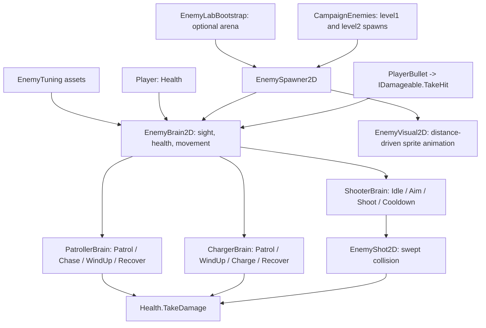

# Script map

The base shares mechanics, while each subclass owns its own transitions and attack behaviour. EnemyTuning provides persistent Inspector values. CampaignEnemies adds all three types to each normal level and removes legacy patrol duplicates; original scene content stays intact. EnemySpawner2D shares construction with the optional lab, which switches to level1 after clearing. The lab displays state labels for the video. Campaign enemies use the same red warning tint without overhead debug labels.
