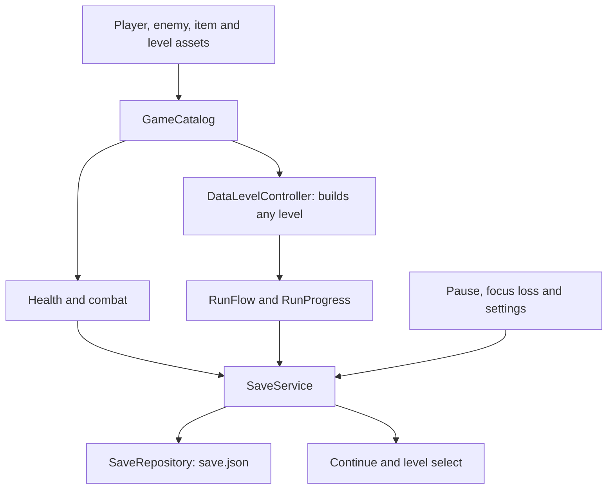

# Script map

RunProgress contains deterministic attempt/completion changes and carries remaining HP. RunFlow handles navigation and save timing. DataLevelController owns the built world, checkpoints, timer and goals. SaveRepository alone handles JSON file reads/writes and malformed-file fallback; it accepts a directory so tests can use temporary files. AppSaveLifecycle persists on pause/focus loss/quit. WebSaveSync flushes browser filesystem writes. UI reads the saved unlocks and asks for confirmation before resetting progress.
