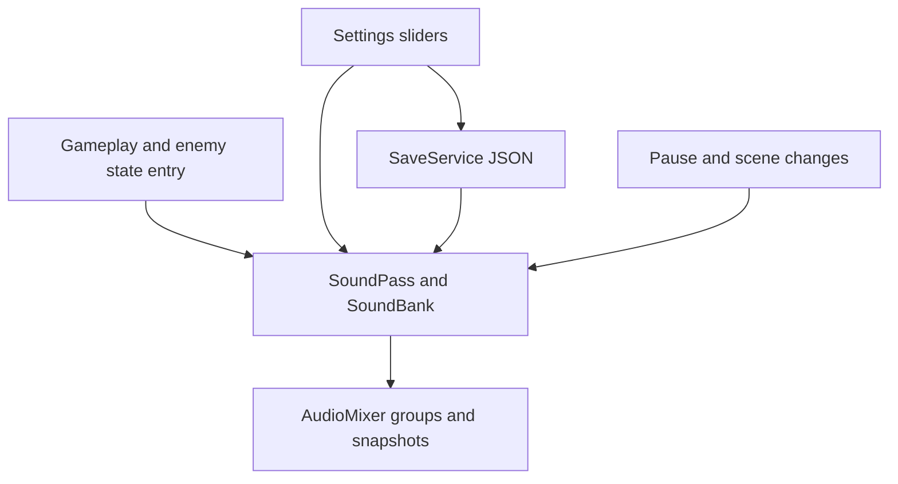

# COINBOUND — Assignment 12: Sound Pass

Unity **6000.6.2f1** · Windows keyboard + phone touch controls · Web export for iPhone Safari.
Based on the playable Assignment 11 project: three ScriptableObject levels, enemy AI, JSON saves, persistent remaining HP, the higher jump and direct keyboard controls are retained.

## Open and play

1. Extract the whole project. In Unity Hub add the folder containing `Assets`, `Packages` and `ProjectSettings`.
2. Open with **6000.6.2f1**, wait for packages/import, then open `Assets/mainmenu.unity` and press Play.
3. Select **NEW RUN** (or CONTINUE for an existing save). A/D or arrows move, Space/W/Up jump, X shoots. Click the Game view before using a keyboard. On a phone use MOVE/JUMP/FIRE.
4. Run **Tools > Assignment 12 > 1. Check Audio Assets and Save**; in Play Mode run **3. Audit Live Audio Routing**. `Sound Audition` is for inspecting individual clips, not gameplay proof.
5. For Windows/Safari build instructions, real-device tests and submission: [START_RU](Docs/Assignment12/START_RU.md). The project ZIP excludes Library, Temp and builds.

## Sound implementation

- **19 events**: jump, player hit, coin, heal, player shot, each of three enemy wind-ups, both boss wind-ups, enemy shot, strike, enemy hit/death, player death, UI click, win, lose and level clear.
- `SoundBank.asset` holds clip references, gains, variation flags, mixer groups, snapshots, crossfade duration and music. Audio balance is editable data.
- `Coinbound.mixer`: Master → Music → PauseDuck, and Master → SFX. Every audible source is routed. Master has −3 dB headroom. Two persistent sources crossfade for one second using unscaled time; the same level track keeps its playback position across level loads/restarts. Legacy Music components stop their old source and delegate to SoundPass.
- Music and SFX **touch sliders** in Settings store linear 0–1 values in last week's `save.json`; mixer gain uses `20 * Log10(value)`. 0 = −80 dB/mute, 0.5 ≈ −6.02 dB, 1 = 0 dB. Existing saves remain compatible; Reset Progress preserves both settings.
- `Paused` snapshot lowers the independent music PauseDuck bus by **12 dB** and its lowpass cutoff to **1600 Hz** over 0.25 seconds. `Normal` restores 0 dB/22000 Hz. The MusicDb user setting is independent, so moving a slider does not defeat ducking. The mixer uses unscaled time and music remains audible while gameplay is frozen.
- Web supports mixer gain but not native mixer effects. Web builds blend synchronized prefiltered copies of the two compositions during pause and interpolate PauseDuckDb. Native Windows/iOS and the Editor use the real snapshot filter. This fallback needs listening on the actual Safari build.
- Repeated short cues vary pitch **0.92–1.08**; warning patterns and outcome jingles keep stable pitch. A bounded pool of 16 SFX voices permits overlapping cues. Warnings fire once on state entry before the attack delay, not every Update. Warnings are intentionally louder than shots; the final mix still needs an ears test.
- Death and lose are separate cues; lose follows death after 0.45 seconds of realtime. A scene change cancels that delayed cue. Winning the campaign triggers Win; ordinary level exits trigger LevelClear.

## Every sound and track: source and license

**All audio currently shipped in this project is original procedural synthesis produced for this task with Codex assistance. No downloaded recordings, commercial songs or third-party samples are used.** Reproducible source: [`Tools/generate_audio.py`](Tools/generate_audio.py), Python 3 + NumPy, fixed random seed. The generated audio, note sequences and synthesis recipe are dedicated to **[CC0-1.0](https://creativecommons.org/publicdomain/zero/1.0/)** to the extent rights exist; see [AUDIO_LICENSE](AUDIO_LICENSE.md). Attribution is optional under that dedication; this table preserves provenance for grading. This dedication covers audio, not the pre-existing game art or Unity packages.

All canonical files below are in `Assets/Resources/GameAudio/`. Every row has the same source (the generator above) and license (CC0-1.0).

| File | Event / role | Source technique |
| --- | --- | --- |
| jump.wav | Successful jump | Rising oscillator sweep |
| hurt.wav | Player receives damage | Falling sweep + seeded noise |
| coin.wav | Coin collected | Two-note bell |
| heal.wav | Heart collected | Three-note bell |
| shoot.wav | Player fires | Short falling sweep |
| patroller_windup.wav | Patroller begins WindUp | Three rising warning notes |
| shooter_windup.wav | Shooter enters Aim | Two high notes separated by a gap |
| charger_windup.wav | Charger begins WindUp | Low rising buzz |
| boss_fan_windup.wav | Boss fan warning | Four rising notes |
| boss_rain_windup.wav | Boss rain warning | Alternating high pattern |
| enemy_shot.wav | Shooter / boss releases projectiles | Sweep + noise |
| enemy_strike.wav | Melee strike / charge release | Low noise sweep |
| enemy_hit.wav | Enemy / boss damaged | Short impact sweep |
| enemy_death.wav | Enemy / boss destroyed | Descending notes |
| death.wav | Player dies | Long falling sweep |
| ui_click.wav | Menu, pause and settings button | Short bell |
| win.wav | Campaign victory | Four ascending notes |
| lose.wav | Loss result | Four descending notes |
| level_clear.wav | Next-level exit | Three ascending notes |
| menu_music.wav | Menu + win screen, original 16 s loop | Sparse bell melody and soft arpeggios |
| level_music.wav | Gameplay, different original 16 s loop | Faster bell sequence, bass and synthesized percussion |
| menu_music_lowpass.wav | Web pause copy of menu theme | Same composition, two-pole lowpass at 1600 Hz |
| level_music_lowpass.wav | Web pause copy of level theme | Same composition, two-pole lowpass at 1600 Hz |
| music.wav | Compatibility alias | Exact copy of level_music.wav |

Legacy `Assets/Audio/{jump,coin,hurt,shoot,win}.wav` are exact copies of the identically named canonical files; `boss_hit.wav` copies enemy_hit.wav and `music.wav` copies level_music.wav. They have the same generated source and CC0 dedication. Existing .meta GUIDs are kept so old scene references remain valid. There is no unknown-provenance old audio left in those files.

Pre-existing art provenance: [Docs/ASSET_SOURCES.md](Docs/ASSET_SOURCES.md). No new art was added for this assignment.

## Script map

- `PlayerController`, `Health`, pickups, `PlayerShooter` and enemy/boss states request events via `Sfx`. Sounds are consequences of actual accepted actions: blocked jumps or cooldown-rejected shots do not make a sound.
- `SoundPass` owns lifetime, voice reuse, track selection/crossfade, pause transitions and source routing. `SoundBank` supplies the editable audio data. `Music`/`Sfx` retain compatibility with old serialized components.
- `MobileGameUI/Assignment11UI.cs` builds sliders; `SaveService`/`SaveRepository` persist settings and progress. A linear save value is converted to dB only at the mixer boundary.
- Web only: aligned filtered tracks reproduce pause muffling where Unity's native lowpass effect is unavailable. The same saved mixer gains still apply.

## Validation and submission status

Offline checks are recorded in [VALIDATION](Docs/Assignment12/VALIDATION.md). Run `python Tools/verify_assignment12.py` (NumPy) and the three existing verification scripts. Optional C# syntax parsing requires `tree-sitter` and `tree-sitter-c-sharp`. These checks do **not** compile against Unity or run the game.

**Unity is unavailable in the preparation environment. Unity import/semantic compilation, listening, real iPhone play/relaunch, an actual mixer screenshot and the student's spoken video are pending. No APK/IPA, Web build, screenshot or proof video is represented as produced.** The ZIP contains a complete source project, not a tested executable build.

Submit a separate Assignment 12 repository link with current-week commits and DECISIONS.md; include a real AudioMixer screenshot and a 2–3 minute MP4 with game audio and your own English narration. For iPhone users the brief allows a phone recording in place of an APK. A Safari demonstration may need your instructor's acceptance if a native app is expected. Recording guide: [VIDEO_EN](Docs/Assignment12/VIDEO_EN.md). Do not submit the audition window as the ears test, or an invented video as device proof.

The included decisions were recorded on 2026-11-26. They are not backdated to imply work on other days. Earlier assignment docs remain in Docs as history; Assignment12 documents govern this submission.

## Technical references

- [Unity: SetFloat](https://docs.unity3d.com/6000.0/Documentation/ScriptReference/Audio.AudioMixer.SetFloat.html): Start-or-later calls and exposed parameter behaviour.
- [Unity: Audio in Web](https://docs.unity3d.com/6000.0/Documentation/Manual/webgl-audio.html): browser audio restrictions and mixer gain support.
- [Unity: AudioMixerSnapshot](https://docs.unity3d.com/6000.0/Documentation/ScriptReference/Audio.AudioMixerSnapshot.html).
- Mixer serialization layout was checked against Unity Technologies' [NativeAudioPlugins](https://github.com/Unity-Technologies/NativeAudioPlugins) sample mixer type information. No sample audio or source implementation was copied into this project.
